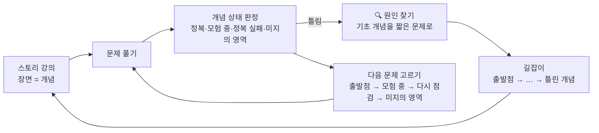

# CS 개념 온톨로지 · 학습 코치

독학사 컴퓨터공학 「통합컴퓨터시스템」과 「알고리즘」을 **개념 온톨로지(개념 + 선행 관계)** 로 다시 엮고,
그 위에 **스토리 강의 · 문제 · 학생 지식 상태** 를 얹은 학습 코치입니다.

개념마다 **🚩 정복 · 🧭 모험 중 · 💥 정복 실패 · 🌫️ 미지의 영역**을 정해진 규칙으로 표시하고(확률 계산 없음),
틀린 문제를 "틀렸다"로 끝내지 않고 **그 개념이 기대는 기초 개념(선행 개념)을 🔍 원인 찾기 문제로 하나씩 물어서 어디서부터 모르는지(출발점)** 찾습니다.

- 학습 코치: https://charming-chanmin.github.io/cs-ontology-agent/
- 온톨로지 탐색기: https://charming-chanmin.github.io/cs-ontology-agent/explorer.html
- MCP 서버: `src/server.js` (어떤 AI 에이전트든 같은 개념 지도를 도구로 씀)

## 왜 만들었나

시험을 준비하면서 개념은 외웠는데 문제가 조금만 바뀌면 풀지 못했습니다.
틀린 문제를 다시 보니 원인은 그 문제가 아니라 **그 밑에 깔린 선행 개념**에 있었습니다.

AI에게 그냥 "왜 틀렸어?"라고 물으면 물을 때마다 설명이 달라지고, 내가 어제 뭘 틀렸는지 모르고, 선행 순서를 매번 다르게 말합니다.
그래서 역할을 나눴습니다.

| 누가 | 맡는 일 |
|---|---|
| **온톨로지** | 바뀌면 안 되는 것: 개념, 선행 관계, 시험 범위와 비중. AI가 지어내지 못하게 하는 뼈대 |
| **코드(엔진)** | 정해진 규칙: 개념 상태 판정, 출발점 찾기(길잡이), 원인 찾기 문제, 다음 문제 고르기, 복습 일정 |
| **AI (Claude)** | 사람 선생만 하던 일: 서술·계산 답안 채점, 틀린 이유 설명, 개념 자료로 새 문제 만들기, 오늘 계획 짜기 |

## 학습 루프



**1. 개념 상태: 확률 대신 규칙** (그 개념 문제를 직접 푼 기록만 봅니다)

| 상태 | 규칙 |
|---|---|
| 🚩 정복 | 그 개념 문제를 **3번 연속** 맞힘 |
| 🧭 모험 중 | 마지막에 맞혔지만 아직 3번 연속이 아님 (1/3, 2/3으로 표시) |
| 💥 정복 실패 | 마지막에 틀림 (다시 3번 연속 맞히면 정복) |
| 🌫️ 미지의 영역 | 아직 안 풂 |

- 3번 연속이 같은 문제 외우기로 채워지지 않게, 개념마다 최근에 푼 **문제 모양**(규격 패턴·계산 유형·강의 문제)을 기억해 두고 다음 확인에서는 다른 모양을 냅니다. 모든 개념이 서로 다른 모양 3가지 이상으로 확인될 수 있습니다.
- 규칙 숫자(몇 번 연속인지, 복습 간격)는 `app/src/coach.js`의 `RULES` 한 곳, 상태 이름·설명은 `app/src/copy.js` 한 곳에 있습니다.

- 정복하면 3일 → 7일 → 14일 → 30일 뒤에 ⏳ 다시 점검할 때가 됐다고 알려 줍니다.
- 여러 개념을 같이 묻는 문제를 틀리면 주 개념만 정복 실패로 바꾸고, 나머지는 원인 찾기에서 따로 확인합니다.
- 화면의 모든 상태 옆에 "판단 근거"(예: 연속 2번 맞혔어요 · 1번 더 맞히면 정복)와 최근 기록(✓✗)을 보여 줍니다.

**2. 길잡이: 온톨로지로 출발점 찾기**

- **출발점** = 정복 실패인데 선행 개념 중에는 정복 실패가 없는 개념 → 여기부터 공부하면 됩니다.
- **막힘** = 정복 실패인데 선행 개념 중에도 정복 실패가 있는 개념 → 선행부터.
- 정복 실패 개념에서 선행 쪽으로 정복 실패를 따라 내려가 출발점을 모으고, 출발점마다 "이걸 정복하면 이어서 풀리는 정복 실패 개념"과 공부 순서(출발점 → … → 틀린 개념)를 보여 줍니다.

**3. 🔍 원인 찾기: 틀리면 기초 개념(선행 개념)을 짧은 문제로**

- 틀린 개념의 선행 중 확인 안 된 것(미지의 영역·모험 중)을 중요한 것부터 하나씩 묻습니다. 틀리면 그 선행도 정복 실패 → 한 칸 더 내려갑니다.
- 이미 정복 실패인 선행이 있으면 묻지 않고 그쪽으로 내려갑니다.
- 더 물을 선행이 없으면, 찾은 개념을 다른 문제로 한 번 더 묻습니다. 한 번 틀린 게 실수였는지 가리려고요 (두 번 연속 틀린 개념은 다시 묻지 않음).
- 학생의 자기 신고("설명할 수 있어?")에 기대지 않고 문제로 확인합니다.

**4. 다음 문제**: 출발점(정복 실패) → 모험 중 → 다시 점검할 때 된 정복 → 미지의 영역 중 중요 개념 순으로 고릅니다. 방금 푼 개념은 10분 쉬었다 내고, 2번 연속 틀린 개념은 강의를 다시 읽은 뒤에 냅니다.

## 문제는 이렇게 만듭니다

교재 문제를 그대로 옮기는 게 아니라, **개념을 제대로 묻는지**를 기준으로 만듭니다. 한 문제씩 손으로 쓰지 않고 규격 → 생성기 구조로 갑니다.

**1. 개념 규격 출제** (`app/specs/*.json` → `app/src/specgen.js`)

개념마다 지식을 JSON 규격으로 한 번만 씁니다. 생성기가 보기 조합을 바꿔 가며 문제를 계속 만듭니다.

```json
{ "c": 85,
  "facts": [
    {"t": "선점 방식은 실행 중인 프로세스의 CPU를 운영체제가 빼앗을 수 있다", "why": "타이머 인터럽트로 OS가 회수"},
    {"f": "비선점 방식은 응답 시간이 짧아 대화형 시스템에 유리하다", "fix": "대화형 시스템에는 선점 방식이 유리하다", "why": "긴 작업이 CPU를 놓지 않는다"}],
  "compare": {"items": ["선점", "비선점"], "rows": {"대표 알고리즘": {"선점": "RR·SRT·MFQ", "비선점": "FCFS·SJF·HRN"}}} }
```

| 규격 | 만들어지는 문제 |
|---|---|
| `facts` 참/거짓 문장 | 옳은 것은? · 옳지 않은 것은? |
| `compare` 비교표 | A의 특징은? · A와 B 비교로 옳지 않은 것은? |
| `terms` 용어↔정의 | 다음 설명에 해당하는 것은? · 용어 쓰기(단답, 자동 채점) |
| `seq` 순서 | 올바른 순서는? · 다음 단계는? |
| `classify` 묶음 | 다음 중 ~에 속하지 않는 것은? |
| `essay` 서술형 | 핵심어 채점 (Claude 안에서는 AI 채점) |

- 보기마다 해설이 붙습니다. 틀린 문장에는 `fix`(맞게 고치면)가 있어서 오답 정리가 됩니다.
- 오답 보기는 같은 개념, 같은 장의 규격에서만 뽑습니다.
- 규격 81개(통컴시 54 · 알고리즘 27): 출제 비중이 높은 개념과, 강의 문제가 0~1개뿐이라 연속 정답을 확인할 수 없던 개념부터 채웠습니다.

**2. 계산 자동 출제** (`app/src/calcgen.js`): 스케줄링(FCFS·SJF·SRT·RR·HRN), 페이지 교체, 디스크 스케줄링, 진법·2의 보수·그레이·해밍, 파이프라인, CPU 성능, 캐시, MAR·MBR, RAID, 후위 표기, 정렬 회전, 이진 탐색, BST·힙, 해싱, DFS·BFS, 다익스트라, 크루스칼, 위상 정렬, 시간 복잡도까지 29유형. 숫자는 매번 새로 뽑고, 정답과 풀이는 코드가 계산합니다.

**3. 강의 속 문제**: 통컴시 357개 · 알고리즘 128개. 보기마다 해설이 있습니다.

그래도 문제가 모자라는 개념은 개념 지도에서 만든 두 가지 문제로 확인합니다: "이 문제를 해결하려고 나온 개념은?"(왜 생겼나를 보여 줌)과 "이 설명에 해당하는 개념은?"(핵심 내용을 보여 줌). 지문 속 개념 이름과 영문 약어는 □□로 가립니다.

### 검증

- 계산 생성기: 교과서 고정 사례(SRT 평균 대기 6.5, 페이지 부재 FIFO 15·LRU 12·OPT 9, 디스크 FCFS 640·SSTF 236 등) + 29유형 × 500문제의 정답 일치 (`app/test/calc.test.mjs`)
- 규격 생성기: 규격 81개로 만든 118,071문제 전부 보기 4개 중복 없음 · 정답 1개 · 보기마다 해설 · 서술형 모범답안이 자기 핵심어 채점 통과 (`app/test/spec.test.mjs`)
- 글자 점검: 강의 문제 · 규격 문제 · 계산 문제 · 개념 지도 문제 · 화면 문구에서 화면에 찍히는 글자 13만여 개를 실제로 만들어 undefined·NaN·두 번 이스케이프된 `&lt;`·마크다운 기호·중복 보기·조사(을/를·은/는·이/가·과/와·으로/로) 틀림이 없는지 검사 (`app/test/text.test.mjs`)

### 검증: 가상 학생 시뮬레이션 (`app/test/sim.mjs`)

모르는 개념 하나(와 그 개념 위에 쌓인 개념들)를 정해 둔 가상 학생에게 40문제를 풀게 하고, 엔진이 출발점을 찾아내는지 봤습니다.
가상 학생은 아는 문제를 8% 확률로 실수하고, 모르는 객관식은 찍어서 25% 맞힙니다.

- 진짜 원인(또는 바로 다음 개념)을 출발점으로 짚음: **24/25** (모르는 개념 6종 × 시드 5개 중, 40문제 동안 그쪽 문제를 한 번이라도 틀린 25번)
- 엔진이 짚은 출발점 중 실제로 모르는 개념: **84%** (나머지는 실수 8%가 겹친 경우)
- 다 아는 학생 40문제: 출발점 0개

실제 학생 데이터가 아니라 시뮬레이션 결과입니다.

## 학습 코치 화면

| 화면 | 하는 일 |
|---|---|
| **길잡이** | 맨 위 **지금 할 일**(지금 기록에서 가장 먼저 할 일 하나 + 큰 버튼), 어디서부터 공부할까요?(출발점 한 줄씩: 정복하기 · 강의 · 🔍 기초 풀어 보기), 개념 정복 현황(숫자를 누르면 지도에서 그 상태만), 이어서 하면 좋은 것, 최근 푼 문제(누르면 그 개념), 접힌 기록 · 설정 |
| **문제** | 오늘의 10문제 · 진단 12문제 · 다시 도전 · 다시 점검 · 강의별 · 「X」 정복하기. 문제마다 묻는 개념, 보기별 해설, 상태 변화(🌫️ 미지의 영역 → 🧭 모험 중 1/3), 원인 찾기 |
| **강의** | 통컴시 16강 · 알고리즘 13강 스토리 강의. 장면 끝에서 그 개념 문제를 풀면 바로 반영. 「안 읽은 장면으로」 |
| **지도** | 개념을 장별 칸으로. 칸마다 상태 아이콘과 글자(💥 정복 실패 · 출발점), 상태별 거르기(⏳ 다시 점검 포함). 누르면 개념 창: 할 일 버튼(정복하기·강의), 판단 근거, 최근 기록, 먼저 알아야 할 것 / 이걸 알면 배울 것, 기초 개념 그림 |

- **처음 쓰는 사람 안내**: 처음 열면 "여기 처음 오셨나요?"를 묻고, 처음이면 10단계 둘러보기를 보여 줍니다 (설명하는 곳만 밝게 비추고 나머지는 흐리게). 화면 곳곳의 **?** 버튼은 그 부분 설명을 작은 말풍선으로 띄우고, 첫 피드백·첫 원인 찾기 때는 설명이 한 번 저절로 뜹니다.
- **공부할 때 화면 이해에 머리 쓰지 않게** (0.7 편의성 패치): 같은 뜻은 같은 낱말로(기초 개념 · 🔍 원인 찾기), 화면마다 누를 버튼은 하나가 가장 크게, 답하면 결과로 자동 스크롤, 다음 버튼은 화면 아래 고정, 다른 화면에 다녀와도 「← 풀던 문제로」, 폰에서 지도 개념 창은 아래에서 올라오고 닫으면 보던 자리 그대로. 자세한 규칙은 [`app/SPEC.md`](app/SPEC.md).
- 기록은 Claude 안에서 열면 Claude 계정에(기기 간 동기화), 아니면 그 브라우저에 저장됩니다.
- AI 기능(채점·튜터·새 문제·코치)은 Claude 안에서 열 때만 켜집니다. 공개 페이지에는 API 키를 넣을 수 없어서입니다.

## 데이터

| | 통컴시 | 알고리즘 |
|---|---|---|
| 개념 | 145 (+ 범위 밖 2) | 73 |
| 선행 관계 | 222 | 131 |
| 강의 / 장면 | 16강 / 137 | 13강 / 73 |
| 강의 속 문제 | 357 | 128 |
| 계산 자동 출제 | 17유형 | 12유형 |
| 개념 규격 | 54개념 | 27개념 |

- 통컴시 개념·선행 관계는 `source/concept-map.md`(교재 문제와 공식 평가영역을 분석해 정리한 개념 표)에서, 알고리즘은 강의 구조를 보고 직접 정의했습니다 (`app/scripts/build_data.py`의 `ALG_PRE`).
- 강의와 강의 속 문제는 스토리 강의 원고에서 뽑았습니다.
- 개념별 출제 비중(★·출제 비중)은 교재와 공식 예시를 보고 정한 추정치입니다.
- 알고리즘 개념 중 강의에 개념 카드가 없던 26개는 '왜 필요한가 / 핵심'을 따로 썼습니다 (`app/scripts/clean_concepts.py`).

## 온톨로지 탐색기 (`docs/explorer.html`)

- **계보 보기**: 개념을 고르면 이해하는 데 필요한 선행 개념이 위에서 아래로 펼쳐집니다.
- **전체 지도**: 147개 전체와 선택한 개념의 계보
- **문제·진단**: 개념 지도에서 만든 문제를 풀고 오답을 진단합니다.

## MCP 도구

| 도구 | 하는 일 |
|---|---|
| `search_concepts` | 낱말로 개념 찾기 |
| `get_concept` | 개념 정의·중요도·출제 정보·앞뒤 개념 |
| `get_prerequisite_path` | 선행 개념 전체를 깊이별로 |
| `generate_quiz` | 지도에서 문제 만들기 (정답은 빼고 돌려줌) |
| `grade_quiz` | 같은 seed로 채점, 틀린 이유와 약한 개념 |
| `rank_shared_prerequisites` | 여러 개념의 공통 선행 개념 순위 |
| `diagnose_wrong_answers` | 다단계 오답 진단 (질문 → 답 반영 → 복습 순서) |

리소스: `ontology://schema` (클래스, 관계, 규모)

## 실행

```bash
npm install
npm test            # MCP 도구 7개 · 계산 생성기 · 규격 생성기 · 글자 점검 · 가상 학생 시뮬레이션
python3 app/build.py  # 학습 코치 → docs/index.html
```

**Claude Code에 연결**

```bash
claude mcp add cs-ontology -- node /절대경로/cs-ontology-agent/src/server.js
```

**Claude Desktop에 연결**: `claude_desktop_config.example.json` 내용을 설정 파일에 넣습니다.

> 하드웨어 범위로 문제 10개 내 줘. 다 풀면 채점하고 오답 진단까지 해 줘.

## 구조

```
app/SPEC.md            학습 코치 구조 명세 (무엇을 바꾸려면 어디를 고치는지)
app/src/coach.js       개념 상태 규칙(RULES) · 길잡이(출발점) · 원인 찾기 · 문제 고르기 엔진
app/src/copy.js        화면 문구 사전: 상태 이름·도움말·둘러보기 문구
app/src/tour.js        안내 장치: 처음 방문 질문 · 둘러보기 · ? 말풍선
app/src/app.js         화면 · 세션 · 저장
app/src/specgen.js     개념 규격 → 문제 생성기 (app/specs/*.json)
app/src/calcgen.js     계산 문제 생성기 29유형
app/src/template.html  뼈대 (+ app.css · lecture.css) → app/build.py → docs/index.html
app/data/*.json        개념·강의·강의 속 문제 (app/scripts/build_data.py로 생성)
app/test/              계산·규격 생성기 검사, 글자 점검, 가상 학생 시뮬레이션
app/scripts/           데이터 만들기(build_data.py), 개념 글자 다듬기(clean_concepts.py), 추가 규격(specs_more.py)
src/ontology.js        온톨로지 추론 (MCP 서버와 탐색기)
src/quiz.js            개념 지도 문제 생성기 (학습 코치·탐색기·MCP 공용)
src/server.js          MCP 서버
docs/                  GitHub Pages (index.html = 학습 코치, explorer.html = 탐색기)
```
