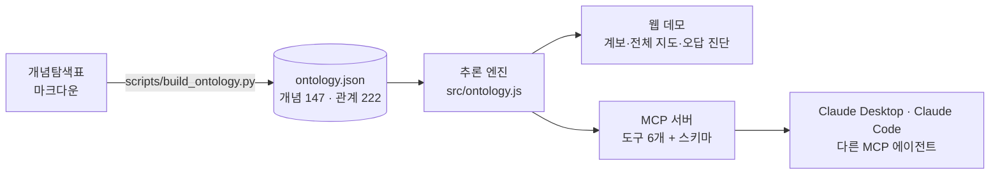

# CS 개념 온톨로지 · 오답 진단 에이전트

독학사 「통합컴퓨터시스템」 문제집을 **개념 147개와 선행 관계 222개로 된 온톨로지**로 다시 엮고,
그 지도를 따라 **틀린 문제의 진짜 원인(막힌 선행 개념)을 거꾸로 찾는 진단 에이전트**를 만들었습니다.
같은 지식 지도를 **MCP 서버**로 열어 두어서, 어떤 AI 에이전트든 연결해 쓸 수 있습니다.

- 웹 데모: `docs/index.html` (GitHub Pages로 바로 열림)
- MCP 서버: `src/server.js`

## 왜 만들었나

시험을 준비하면서 개념은 외웠는데 문제가 조금만 바뀌면 풀지 못했습니다.
틀린 문제를 다시 보니 원인은 그 문제가 아니라 **그 밑에 깔린 선행 개념**에 있었습니다.
개념 하나하나보다 **개념 사이의 연결**이 없었던 것입니다.

그래서 개념과 연결을 데이터로 만들고(온톨로지), AI가 그 연결을 따라 판단하게 했습니다.
AI 에이전트가 잘 일하려면 문서 조각이 아니라 **관계가 정의된 맥락**이 필요하다는 것을 직접 확인한 프로젝트입니다.

## 구조



## 온톨로지 스키마

| 클래스 | 수 | 관계 |
|---|---|---|
| Concept | 147 | `Concept ─prerequisite_of→ Concept` (222) |
| Chapter | 22 | `Concept ─belongs_to→ Chapter` |
| ExamItem | 253 | `Concept ─tested_by→ ExamItem` (교재 200문항 중 196개 연결) |

개념마다 `왜 생겼나 / 핵심 / 계산 이유 / 중요도(별 1~5) / 출제 확률(추정)`을 속성으로 가집니다.

**데이터 검증** (`scripts/build_ontology.py`)
- 순환 관계 0개 (위상 정렬 성공, DAG)
- 선행·다음 기록이 양방향으로 222개 모두 일치
- 원본 표의 중요도 분포(★5 27 · ★4 27 · ★3 48 · ★2 38 · ★1 7)와 일치

## 오답 진단은 이렇게 추론합니다

1. 틀린 문제 번호 → `tested_by`로 문제가 묻는 개념을 찾습니다.
2. 그 개념들의 선행 개념을 모두 모아, **여러 개념이 공통으로 기대는 가장 구체적인 선행 개념**을 고릅니다.
   (공유 수가 같거나 큰 다른 후보의 조상이면 뺍니다.)
3. 학생에게 그 개념을 설명할 수 있는지 묻습니다.
   알면 그 개념과 조상을 지우고, 헷갈리면 그 밑으로 더 파고듭니다.
4. 가장 깊은 "헷갈림" 개념을 막힌 지점으로 보고, 거기서 틀린 개념까지 이어지는 길을 복습 순서로 냅니다.

## MCP 도구

| 도구 | 하는 일 |
|---|---|
| `search_concepts` | 낱말로 개념 찾기 |
| `get_concept` | 개념 정의·중요도·출제 정보·앞뒤 개념 |
| `get_prerequisite_path` | 선행 개념 전체를 깊이별로 |
| `find_concepts_for_exam_items` | 문제 번호 → 개념 |
| `rank_shared_prerequisites` | 여러 개념의 공통 선행 개념 순위 |
| `diagnose_wrong_answers` | 다단계 오답 진단 (질문 → 답 반영 → 복습 순서) |

리소스: `ontology://schema` (클래스, 관계, 규모)

## 실행

```bash
npm install
npm test        # 서버를 띄워 6개 도구를 실제로 호출하는 확인
```

**Claude Code에 연결**

```bash
claude mcp add cs-ontology -- node /절대경로/cs-ontology-agent/src/server.js
```

**Claude Desktop에 연결**: `claude_desktop_config.example.json` 내용을 설정 파일에 넣습니다.

연결한 뒤 이렇게 말하면 됩니다.

> 교재 056, 093, 065, 113번을 틀렸어. 오답 진단해 줘.

## 웹 데모

`docs/index.html` 하나로 동작합니다. 저장소 설정에서 GitHub Pages를 `main` 브랜치의 `/docs`로 켜면 링크로 열 수 있습니다.

- **계보 보기**: 개념을 고르면 이해하는 데 필요한 선행 개념이 위에서 아래로 펼쳐집니다.
- **전체 지도**: 147개 전체와 선택한 개념의 계보
- **오답 진단**: 위 추론을 화면에서 단계별로 진행합니다. Claude 안에서 열면 AI 코치가 같은 도구를 호출해 진단을 설명합니다.

## 데이터

`source/concept-map.md`는 교재 문제와 공식 평가영역을 분석해 직접 정리한 개념 표입니다.
교재 문제는 번호로만 참조하며 문제 본문은 담지 않았습니다. 출제 확률은 추정치입니다.
